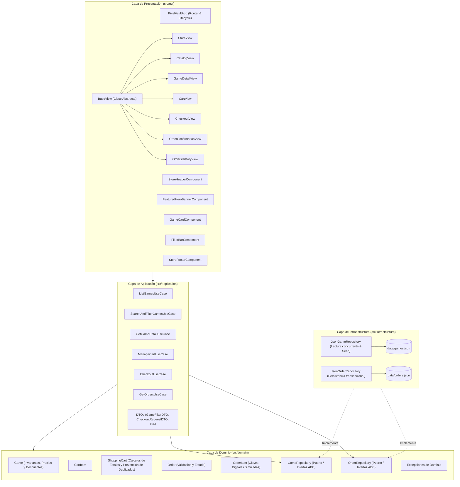
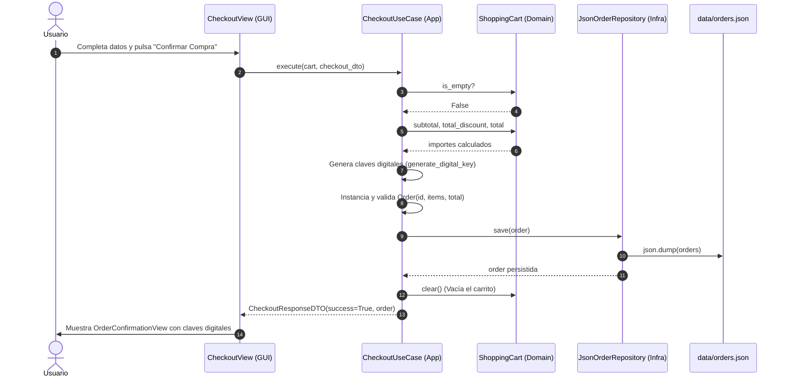

# Arquitectura de Software — PixelVault

## 1. Introducción y Propósito
**PixelVault** es una plataforma web para una tienda digital de videojuegos inspirada visualmente en el diseño de catálogo consolidado de **Steam** y la identidad independiente y artística de **itch.io**.

El proyecto está diseñado bajo una **Arquitectura en Capas (Layered / Hexagonal Clean Architecture)** en **Python**, utilizando **Flet** como motor de interfaz de usuario reactiva, **uv** para la gestión reproducible de dependencias y **JSON** para la persistencia local desacoplada.

---

## 2. Diagrama General de Arquitectura (Mermaid)

---

## 3. Descripción Detallada de las Capas

### 3.1. Capa de Dominio (`src/domain/`)
Es el núcleo del sistema y no posee dependencias hacia ninguna biblioteca externa ni hacia la interfaz gráfica.
- **`Game`**: Entidad central que encapsula las propiedades del videojuego (título, género, desarrollador, precio base, descuento, valoración, requisitos). Contiene la lógica de negocio para:
  - Cálculo de precio final con descuento: `round(price * (1 - discount / 100), 2)`.
  - Ahorro económico real: `price - final_price`.
  - Invariantes de validación (precios no negativos, descuentos entre 0 y 100%).
- **`CartItem`**: Representa una línea de producto seleccionada con su timestamp y valor unitario.
- **`ShoppingCart`**: Objeto de negocio fundamental que administra los juegos seleccionados:
  - **Garantía de no duplicación**: Un videojuego no puede agregarse dos veces como dos ítems independientes (restricción intrínseca de licencias digitales de software). Si se intenta agregar un juego ya existente, lanza `GameAlreadyInCartError`.
  - **Cálculo de importes**: Subtotal base, descuento global acumulado y total a pagar.
- **`Order` y `OrderItem`**: Representan una compra digital finalizada con generación de identificador único (`PV-2026-XXXX`) y claves de activación de 16 caracteres (`PIXEL-XXXX-XXXX-XXXX`).
- **`ports.py`**: Declara las interfaces abstractas (`GameRepository`, `OrderRepository`) aplicando el principio de Inversión de Dependencias (DIP).
- **`exceptions.py`**: Jerarquía de excepciones semánticas de negocio (`PixelVaultDomainException`, `GameNotFoundError`, `GameAlreadyInCartError`, `EmptyCartCheckoutError`, etc.).

### 3.2. Capa de Aplicación (`src/application/`)
Coordina el flujo de información entre el dominio y los casos de uso específicos requeridos por la tienda:
- **`ListGamesUseCase`**: Entrega catálogos segmentados (Destacados, Super Ofertas, Novedades, Rincón Indie).
- **`SearchAndFilterGamesUseCase`**: Filtra en memoria por coincidencia de texto (título, desarrollador, tags), género, bandera de ofertas, bandera indie y rangos de precios, además de ejecutar ordenamientos múltiples.
- **`GetGameDetailUseCase`**: Obtiene un videojuego por su identificador único o slug amigable.
- **`ManageCartUseCase`**: Expone las operaciones seguras del carrito para la UI.
- **`CheckoutUseCase`**: Orquesta la validación de los datos del comprador, generación de claves criptográficas seguras simuladas, persistencia en disco y vaciado del carrito tras confirmación.
- **`GetOrdersUseCase`**: Lee el historial de compras confirmadas.
- **`dtos.py`**: Objetos planos para transporte de datos (`GameFilterDTO`, `CheckoutRequestDTO`, `CheckoutResponseDTO`) desacoplando la presentación.

### 3.3. Capa de Infraestructura (`src/infrastructure/`)
Implementa los adaptadores técnicos para interactuar con el sistema de archivos local:
- **`JsonGameRepository`**: Implementa `GameRepository`. Lee `data/games.json`. Es seguro ante concurrencia con `threading.Lock()`. Si el archivo no existe o está corrupto, genera automáticamente el catálogo inicial de 18 videojuegos diversos (`SEED_GAMES`).
- **`JsonOrderRepository`**: Implementa `OrderRepository`. Lee y escribe en `data/orders.json`. Guarda de forma persistente cada simulación académica de compra.

### 3.4. Capa de Presentación (`src/gui/`)
Construida 100% sobre controles nativos de Flet en modo Web Browser:
- **`theme.py`**: Paleta de colores curada (Fondo carbón `#0B0E14`, Superficies `#162032`, Violeta Eléctrico `#8B5CF6`, Cian Neón `#06B6D4`, Verde Descuento `#10B981`).
- **Componentes Reutilizables (`src/gui/components/`)**:
  - `StoreHeaderComponent`: Logotipo, enlaces de navegación, barra de búsqueda reactiva y botón de carrito con insignia dinámica de cantidad.
  - `FeaturedHeroBannerComponent`: Banner principal estilo Steam con datos del juego estrella, precio, descuento y compra rápida.
  - `GameCardComponent`: Tarjeta de juego con portada (con respaldo offline seguro), badges, estrellas de calificación, precio tachado y botones de acción.
  - `FilterBarComponent`: Barra de control con campo de búsqueda, selector de géneros, interruptores de ofertas e indies, y selector de ordenamiento.
  - `StoreFooterComponent`: Pie de página académico con mención al IUT Antonio José de Sucre y al profesor de referencia.
- **Vistas Polimórficas (`src/gui/views/`)**:
  - `BaseView`: Clase abstracta que define el contrato `build() -> ft.Control`.
  - `StoreView`: Tienda principal con banner hero y secciones organizadas.
  - `CatalogView`: Catálogo completo interactivo con estados vacíos amigables.
  - `GameDetailView`: Ficha técnica completa del videojuego con requisitos de sistema y sinopsis.
  - `CartView`: Carrito de compras con cálculo en vivo de totales y descuentos.
  - `CheckoutView`: Pantalla de confirmación con formulario y aviso académico.
  - `OrderConfirmationView`: Pantalla de éxito con visualización de claves de activación.
  - `OrdersHistoryView`: Historial de compras para verificación docente.

---

## 4. Aplicación de Principios de Programación Orientada a Objetos (POO)

| Principio | Dónde se aplica en PixelVault | Justificación y Evidencia en Código |
|---|---|---|
| **Encapsulamiento** | `Game`, `ShoppingCart`, `Order` | El estado interno de los ítems en `ShoppingCart._items` es privado. Ninguna vista puede mutar los precios ni agregar ítems saltándose la validación o duplicándolos. |
| **Abstracción** | `GameRepository`, `OrderRepository`, `BaseView` | La capa de aplicación desconoce si los juegos provienen de un archivo JSON, SQLite o una API remota. Solo interactúa con el contrato del puerto abstracto. |
| **Herencia** | `BaseView` -> `StoreView`, `CatalogView`, etc. | Todas las pantallas heredan de `BaseView`, reutilizando la referencia al controlador de página y función de navegación sin duplicar código. |
| **Polimorfismo** | Método `build()` en las vistas y `JsonGameRepository` cumpliendo `GameRepository` | El router de `PixelVaultApp.navigate()` invoca `view_instance.build()` de forma polimórfica sin importar qué vista concreta se esté renderizando. |
| **Inversión de Dependencias (DIP)** | `ListGamesUseCase(game_repo: GameRepository)` | Los casos de uso dependen de abstracciones (`ports.py`) y no de implementaciones concretas de disco. |
| **Responsabilidad Única (SRP)** | Separación de Capas | Las vistas no calculan precios ni abren archivos; los repositorios no diseñan botones; las entidades no manejan la interfaz gráfica. |

---

## 5. Diagrama de Secuencia: Flujo de Compra Simulada

